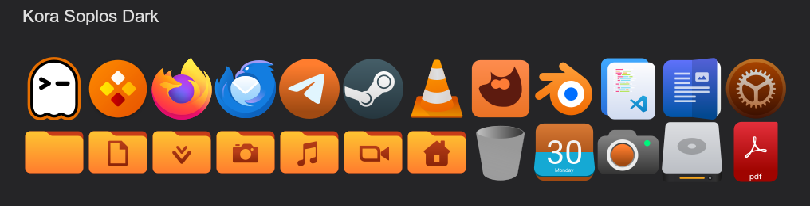
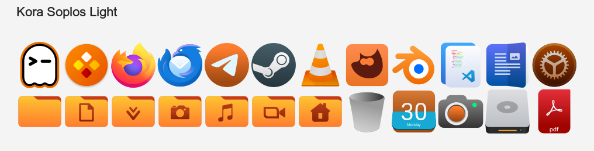

# Kora Soplos Icons

Icon themes for Soplos Linux, derived from the Kora icon theme and recolored with the official Soplos palette.

Two variants are provided:

| Theme | Folder | Inherits |
|-------|--------|----------|
| Kora Soplos Dark | `kora-soplos-dark` | nothing |
| Kora Soplos Light | `kora-soplos-light` | nothing |

Unlike Kora, which ships a single variant, these themes provide a dark and a light version. The dark variant uses light symbols (`#dfdfdf`), the light variant uses dark symbols (`#252527`).

## Preview

Kora Soplos Dark, on a dark background:

Kora Soplos Light, on a light background:

The previews show a sample of the apps, folders, devices and file types. They are rendered from the SVG files of each theme.

## What is included

- More than 9,800 icons per theme: apps, places, devices, mimetypes, status, actions, emblems, categories and panel icons.
- Scalable SVG icons, with `@2` variants for HiDPI screens.
- Symbolic icons that follow the color scheme of the desktop.
- Works with GNOME, KDE Plasma, Xfce and any desktop that follows the freedesktop icon theme specification.

## New in version 1.0.1

- The README says what the themes inherit (nothing) and that the package depends on no other package. The table of the themes still showed the Breeze themes of 1.0.0-8.

## New in version 1.0.0-9

- The themes no longer depend on the icons of another desktop: they inherit nothing, and the package depends on and recommends no other package.

## New in version 1.0.0-8

- The trash and the other symbolic place icons of the sidebars (folders, desktop, recent files, bookmarks, computer, drives, removable media and network) are in color, in both themes.
- Places, devices and applications at 16 px, and the drive, printer, speaker and file manager icons of the panel, use the colored icons instead of gray copies.
- The Other button of the login screen (Plasma Login Manager) uses the round switch user icon of the other buttons.

## New in version 1.0.0-7

- The home icon is no longer a gray monochrome house in the sidebar of file managers such as Thunar: it is the orange home folder, like the other places, in both themes.

## New in version 1.0.0-6

- New icon for the `.sth` theme files of Soplos Theme Manager (`application-x-soplos-theme`), in both themes.

## New in version 1.0.0-5

- The folder icons, the home folder and the trash no longer turn black in small lists, as in Dolphin: the monochrome copies that shared their names are gone, and the orange icons are used at every size.
- The icons of 98 third-party apps, among them Microsoft Edge, LibreWolf, Zoom, Messenger, Joplin, Mumble, OpenShot and digiKam, go back to the original Kora versions instead of the orange recolor.

## New in version 1.0.0-4

- New icons: the `control-centre` panel icon and the `soplos-launcher` app icon.
- The logos `distributor-logo`, `distributor-logo-soplos` and `start-here-soplos` are now the official Soplos logo.
- The icons of the system monitor (`utilities-system-monitor`) and of GNOME Boxes (`gnome-boxes`) are now Soplos orange.
- The icons of the compressed files are now Soplos orange.
- The Telegram icon goes back to the original blue one.

## New in version 1.0.0-3

- Version, license, platform, format and package badges.
- Installation instructions for the `.deb` package of the Releases, on any Debian based distribution.
- The session and power icons have a new circle, charcoal in the dark theme and light gray in the light theme, so the orange symbol is clearly visible at panel size.

## New in version 1.0.0-2

- Package revision 2 of 1.0.0: the Debian package is rebuilt from the current state of the themes.

## New in version 1.0.0

- First release of the Soplos variants of Kora.
- Accent color changed from Kora blue to Soplos orange (`#ff7d2e`); secondary colors taken from the Soplos web palette.
- Orange folder set.
- The cyan gradient of Kora app icons and the blue of the system icons (status, session and power icons, and the apps that belong to the system) are now orange. Weather, Bluetooth, disk quota and the logos of third-party apps and distributions keep their colors.
- Soplos distributor logo (`distributor-logo-soplos`, `start-here-soplos`).
- Soplos Ghostty icon (`com.mitchellh.ghostty`, `ghostty`).
- Light variant with dark symbolic icons and dark panel icons.
- Debian package `kora-soplos-icons`, architecture `all`, for Boro, Tyson and Tyron.
- Icon files with invalid names inherited from Kora are fixed or removed.

## Installation

### Debian package (Debian, Ubuntu and derivatives)

The `.deb` package of every version is published in the [Releases](https://github.com/SoplosLinux/kora-soplos-icons/releases) of this repository. It installs both themes in `/usr/share/icons` and works on any Debian based distribution, such as Soplos Linux Boro, Tyson and Tyron, Debian, Ubuntu or Linux Mint.

1. Download the latest `kora-soplos-icons_<version>_all.deb` from the Releases page.
2. Install it with `apt` (the package depends on no other package):

       sudo apt install ./kora-soplos-icons_<version>_all.deb

   Replace `<version>` with the version you downloaded, for example `1.0.0-3`. Run the command in the folder where you saved the file.
3. Select the theme in the settings of your desktop: Kora Soplos Dark or Kora Soplos Light.
   - KDE Plasma: System Settings, Appearance, Icons.
   - GNOME: GNOME Tweaks, Appearance, Icons.
   - Xfce: Settings, Appearance, Icons.

The icon caches are generated when the package is installed, so there is nothing else to do. To remove the themes, run `sudo apt remove kora-soplos-icons`.

### Manual installation

The themes are meant to be installed in `/usr/share/icons`, one directory per theme. After copying them, refresh the icon cache:

    gtk-update-icon-cache -f /usr/share/icons/kora-soplos-dark
    gtk-update-icon-cache -f /usr/share/icons/kora-soplos-light

## Credits

- **Kora** icon theme - the base of every icon in these themes. All the credit for the original artwork goes to the Kora project and its contributors: https://github.com/bikass/kora
- **Simnandez** - drove and promoted the project.
- **Sergi Perich** - Soplos modifications: recoloring, light variant, Soplos and Ghostty icons, packaging.

## License

GNU General Public License, version 3, the same license as Kora. See `LICENSE`.
