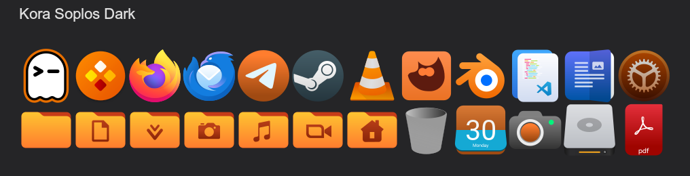
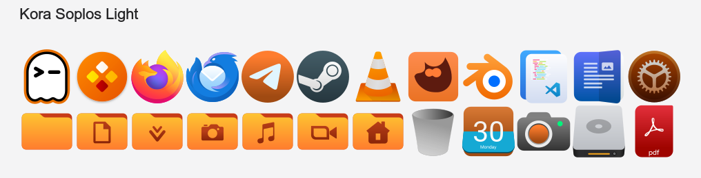

# Kora Soplos Icons

Icon themes for Soplos Linux, derived from the Kora icon theme and recolored with the official Soplos palette.

Two variants are provided:

| Theme | Folder | Inherits |
|-------|--------|----------|
| Kora Soplos Dark | `kora-soplos-dark` | `breeze-dark,breeze,hicolor` |
| Kora Soplos Light | `kora-soplos-light` | `breeze,hicolor` |

Unlike Kora, which ships a single variant, these themes provide a dark and a light version. The dark variant uses light symbols (`#dfdfdf`), the light variant uses dark symbols (`#252527`).

## Preview

Kora Soplos Dark, on a dark background:

Kora Soplos Light, on a light background:

The previews show a sample of the apps, folders, devices and file types. They are rendered from the SVG files of each theme.

## What is included

- More than 9,800 icons per theme: apps, places, devices, mimetypes, status, actions, emblems, categories and panel icons.
- Scalable SVG icons, with `@2` variants for HiDPI screens.
- Symbolic icons that follow the color scheme of the desktop.
- Works with GNOME, KDE Plasma, Xfce and any desktop that follows the freedesktop icon theme specification.

## New in version 1.0.0-2

- Package revision 2 of 1.0.0: the Debian package is rebuilt from the current state of the themes.

## New in version 1.0.0

- First release of the Soplos variants of Kora.
- Accent color changed from Kora blue to Soplos orange (`#ff7d2e`); secondary colors taken from the Soplos web palette.
- Orange folder set.
- The cyan gradient of Kora app icons and the blue of the system icons (status, session and power icons, and the apps that belong to the system) are now orange. Weather, Bluetooth, disk quota and the logos of third-party apps and distributions keep their colors.
- Soplos distributor logo (`distributor-logo-soplos`, `start-here-soplos`).
- Soplos Ghostty icon (`com.mitchellh.ghostty`, `ghostty`).
- Light variant with dark symbolic icons and dark panel icons.
- Debian package `kora-soplos-icons`, architecture `all`, for Boro, Tyson and Tyron.
- Icon files with invalid names inherited from Kora are fixed or removed.

## Installation

The themes are meant to be installed in `/usr/share/icons`, one directory per theme. After copying them, refresh the icon cache:

    gtk-update-icon-cache -f /usr/share/icons/kora-soplos-dark
    gtk-update-icon-cache -f /usr/share/icons/kora-soplos-light

## Credits

- **Kora** icon theme - the base of every icon in these themes. All the credit for the original artwork goes to the Kora project and its contributors: https://github.com/bikass/kora
- **Simnandez** - drove and promoted the project.
- **Sergi Perich** - Soplos modifications: recoloring, light variant, Soplos and Ghostty icons, packaging.

## License

GNU General Public License, version 3, the same license as Kora. See `LICENSE`.
